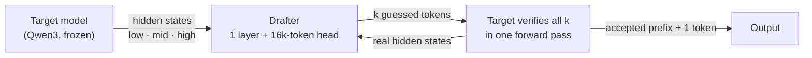

<p align="center">
  
</p>

<h1 align="center">Woodcock</h1>

<p align="center">
  <b>Lossless speculative decoding for Apple Silicon.</b><br>
  Same model, same output — <b>2×</b> faster generation on a Mac.
</p>

<p align="center">
  <a href="https://huggingface.co/AtomicChat/woodcock-drafter-qwen3-1.7b"></a>
  <a href="https://huggingface.co/datasets/AtomicChat/woodcock-training"></a>
  
  
  
  
</p>

---

<p align="center">
  <b>2.00×</b> faster than mlx-lm &nbsp;·&nbsp;
  <b>2.48×</b> on math &nbsp;·&nbsp;
  <b>2.09×</b> on code &nbsp;·&nbsp;
  <b>0 quality loss</b>
</p>

<p align="center"><sub>Qwen3-1.7B on an M4 Max (48 GB), batch 1, greedy, 40 prompts across chat, code, math and 10 languages.
Speedup is against the faster of mlx-lm and our own plain decoder.</sub></p>

---

## Why Woodcock

Large language models generate one token per forward pass, and on a Mac every pass
is limited by how fast the weights stream from memory, not by compute. Woodcock adds
a tiny **drafter** — one transformer layer that reads the big model's own hidden
states — which guesses the next few tokens. The big model then checks all guesses in
**one** forward pass and keeps every token it agrees with.

- **Lossless by construction.** Greedy output is exactly the model's greedy output;
  with sampling, the accept/reject rule reproduces the model's exact token
  distribution. Both are tested (fp32 token-for-token equality on a real Qwen3,
  chi-square tests of the sampled distribution).
- **Built for unified memory.** One host synchronisation per round, a draft head
  restricted to the tokens the model actually uses, and a chain length chosen from
  latencies measured on your machine.
- **Train your own drafter on a Mac** — or on a rented GPU with the same code — from
  permissively licensed data that the target model writes itself.
- **MIT-licensed, written from public papers.** Every design element is traced to an
  arXiv section or marked as our own ([`docs/research.md`](docs/research.md)).

## Benchmarks

M4 Max 48 GB, MLX 0.32, bf16, batch 1, greedy, 256 new tokens per prompt, 10 prompts
per domain (MT-Bench, HumanEval, GSM8K test, Aya). Baseline: mlx-lm `stream_generate`.

### Qwen3-1.7B

| Domain | mlx-lm | **Woodcock** | tokens per round |
|---|---|---|---|
| Math | 121.1 tok/s | **300.8 tok/s · 2.48×** | 3.81 |
| Code | 120.2 tok/s | **251.4 tok/s · 2.09×** | 3.10 |
| Chat | 119.4 tok/s | **213.0 tok/s · 1.78×** | 2.58 |
| Multilingual | 121.1 tok/s | **197.4 tok/s · 1.63×** | 2.26 |
| **All** | **120.5 tok/s** | **240.6 tok/s · 2.00×** | **2.94** |

Drafter v2, trained with this repository on 80k answers written by Qwen3-1.7B itself
(67.5% first-token agreement on held-out answers), 16k-token draft head, `auto` chain
length (4.3 tokens on average).

### Qwen3-4B

| Domain | mlx-lm | Woodcock, drafter v2 |
|---|---|---|
| All | xxx tok/s <!-- TBD --> | **xxx tok/s · x.xx×** <!-- TBD --> |

### Where the speed comes from

| Change | Effect (Qwen3-1.7B, measured) |
|---|---|
| Hidden-state drafter, fused single-sync chains | 1.24× over mlx-lm with the full draft head |
| Draft head cut from 151,936 to the 16k most used tokens | draft step 1.75 → 0.61 ms; tokens per round 2.09 → 2.07 |
| Chain length chosen per round from measured latencies | matches or beats the best fixed length in every domain |
| Drafter retrained on 9× more data (one pass over 80k answers) | tokens per round 2.15 → 2.94; 1.56× → 2.00× |

Full method, raw numbers and every failed attempt: [`docs/journal.md`](docs/journal.md).

## How it works



1. The drafter fuses three layers of the target's hidden states (EAGLE-3) and drafts a
   chain of tokens; its LM head only scores the tokens the target actually produces
   (FR-Spec, VocabTrim).
2. The target scores the whole chain in one pass. Greedy: keep the longest prefix that
   matches the target's own choice. Sampling: speculative sampling (Leviathan et al.,
   Chen et al.), which is exact.
3. The chain length for the next round maximises expected tokens per millisecond
   (Leviathan et al. §3.5) from latencies measured on this machine.

## Quick start

```bash
git clone https://github.com/AtomicBot-ai/woodcock.git && cd woodcock
uv venv --python 3.12 .venv && source .venv/bin/activate
uv pip install -e ".[test]"
python -m pytest -q
```

### Pretrained drafters

| Target | Drafter | Speedup (M4 Max) |
|---|---|---|
| [Qwen/Qwen3-1.7B](https://huggingface.co/Qwen/Qwen3-1.7B) | [AtomicChat/woodcock-drafter-qwen3-1.7b](https://huggingface.co/AtomicChat/woodcock-drafter-qwen3-1.7b) | 2.00× |
| [Qwen/Qwen3-4B](https://huggingface.co/Qwen/Qwen3-4B) | `AtomicChat/woodcock-drafter-qwen3-4b` (training) | x.xx× <!-- TBD --> |

Each drafter repository holds the weights, the token counts for the truncated draft
head (`vocab_counts.npz`) and a model card. Download one, measure this machine's
draft and verify latencies once, and generate:

```bash
hf download AtomicChat/woodcock-drafter-qwen3-1.7b --local-dir drafters/qwen3-1.7b

python scripts/time_draft_step.py --target Qwen/Qwen3-1.7B --drafter drafters/qwen3-1.7b \
  --vocab drafters/qwen3-1.7b/vocab_counts.npz --sizes 16384 --out latency.json

woodcock generate --target Qwen/Qwen3-1.7B \
  --drafter drafters/qwen3-1.7b@drafters/qwen3-1.7b/vocab_counts.npz:16384 \
  --policy auto:latency.json \
  --prompt "Explain speculative decoding in two sentences."
```

### Train your own drafter

```bash
woodcock prompts --config configs/data-v2.yaml --out data/prompts-v2 --only train   # permissive prompt sets
woodcock regen   --config configs/qwen3-1.7b.yaml \
  --set prompts=data/prompts-v2/train.jsonl out=data/regen/qwen3-1.7b-v2.jsonl limit=null  # the target writes the answers
woodcock adapt   --config configs/qwen3-1.7b-v2.yaml                                 # training-time-test distillation
woodcock vocab   --config configs/qwen3-1.7b-v2.yaml --out runs/vocab/qwen3-1.7b-v2.npz
woodcock bench   --config configs/qwen3-1.7b.yaml --target Qwen/Qwen3-1.7B \
  --drafter v2=runs/adapt/qwen3-1.7b-v2/final@runs/vocab/qwen3-1.7b-v2.npz:16384 \
  --policy auto:runs/bench/latency-qwen3-1.7b.json --out runs/bench/v2.json
```

The prompts, the regenerated answers, token counts, training logs and every benchmark
behind the numbers above are in the dataset
[AtomicChat/woodcock-training](https://huggingface.co/datasets/AtomicChat/woodcock-training).
On a Mac this takes many hours; on one rented H100 the 80k answers took 21 minutes
(vLLM, `scripts/cuda/regen_vllm.py`) and training about 1.5 hours alone on the GPU, with the same MLX code
(`scripts/cuda/`).

## Status

| Area | State |
|---|---|
| Drafter (EAGLE-3 / EAGLE-3.1 family), training-time-test training | working, tested |
| Verification: greedy and sampling, chains and trees | working, tested |
| Frequency-truncated draft head, cost-aware chain length | working, tested |
| Data generation (vLLM) and training (MLX CUDA backend) on NVIDIA GPUs | in use; full test suite passes on an H100 |
| Native C++20 runtime (CPU) | real-model inference verified against MLX; truncated head not yet ported |
| Draft trees on the fused path | planned |

In bf16, a batched verification pass can resolve a near-tie between two tokens
differently from a one-token pass, so long greedy outputs may diverge from plain bf16
decoding at such a tie; in fp32 they are identical token for token. Details in the
journal.

## Built on

EAGLE, EAGLE-2, EAGLE-3 and EAGLE-3.1 (hidden-state drafters, training-time test),
FR-Spec and VocabTrim (truncated draft vocabulary), Leviathan et al. and Chen et al.
(speculative sampling), Osprey (step-discounted loss), MLX and mlx-lm. Every
source, licence and dataset: [`docs/provenance.md`](docs/provenance.md).

## Legal

Woodcock is not affiliated with or endorsed by the authors of the papers it builds
on. Sources and licenses: [`docs/provenance.md`](docs/provenance.md). Code: MIT
([`LICENSE`](LICENSE)); drafter weights you train contain weights copied from Qwen3
and are Apache-2.0-derived.
